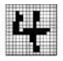
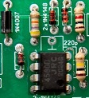
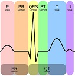
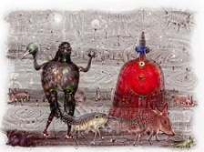

## Course Topics

The [resource library]({{ '/resources/' | relative_url }}) brings together circuit and electronics notes, pattern recognition studies, data engineering materials, and student-authored contributions from the earlier website. See also the [dated graduate research archive]({{ '/student-research/' | relative_url }}).

- [**Pattern Recognition**](https://laboratorypatternrecognition.github.io/PatternRecognition_S/pattern_recognition.html) : Techniques for identifying patterns in data with applications in image, speech, and biometrics.
- [**Machine learning**](https://laboratorypatternrecognition.github.io/MachineLearningS/machine_learning.html): Core algorithms and models for data-driven decision-making and predictive analysis
- [**Circuit analysis**](https://laboratorypatternrecognition.github.io/CircuitElectronics/Introduction_CircuitElectronics.html): Principles of circuit analysis and the operation of electronic components like diodes, transistors, and op-amps
- [**Signal processing**](https://laboratorypatternrecognition.github.io/SignalSystem/SignalSystemStart.html): Techniques for analyzing, filtering, and transforming signals in both time and frequency domains
- [**AI Essentials**](https://laboratorypatternrecognition.github.io/AI-Essentials/Home_Page.html): Fundamentals of artificial intelligence, covering problem-solving, search algorithms, and basic machine learning concepts

## Additional teaching materials



## Locally managed courses




- [**{{ course.title | escape }}**]({{ course.permalink | relative_url }}): {{ course.description | escape }}
  
  
  

- [Data acquisition, processing and management]({{ '/resources/teaching-dataengcourse-data/' | relative_url }})
- [AI for high-school students]({{ '/resources/teaching-ai-hs-introduction/' | relative_url }})
- [AI applications in organizations]({{ '/resources/teaching-organizations-organ-ai/' | relative_url }})

The [resource library]({{ '/resources/' | relative_url }}) also groups student contributions in circuits, electronics, pattern recognition and machine learning, alongside the research toolkit.
