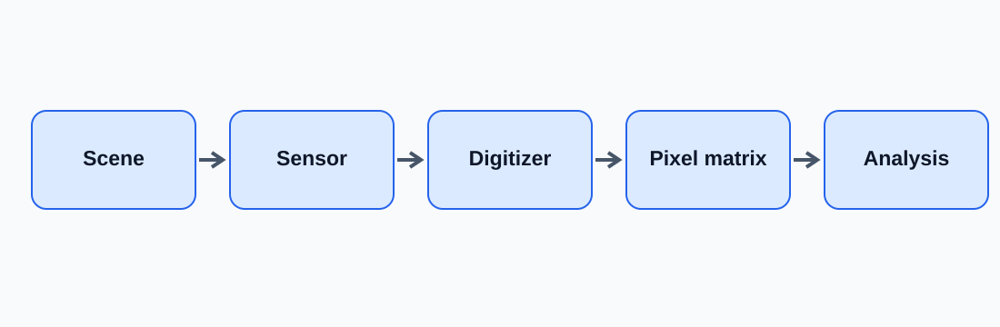
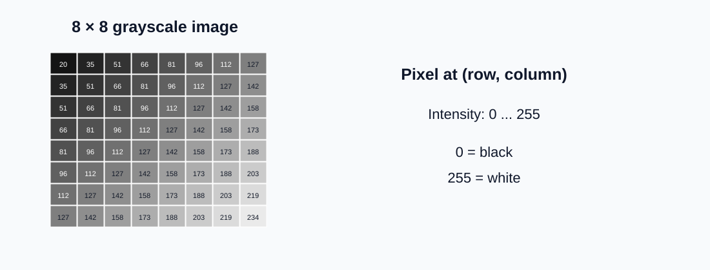
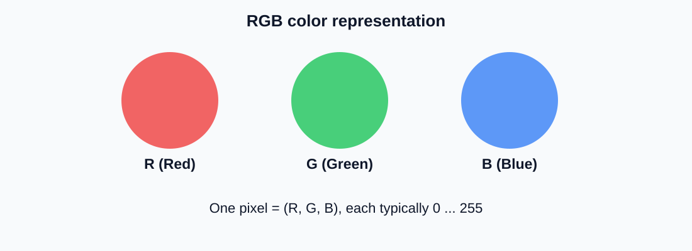
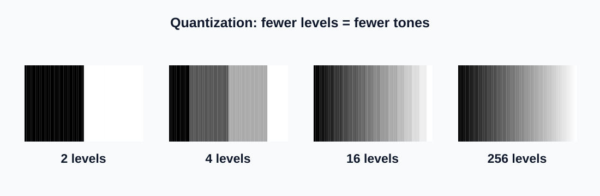
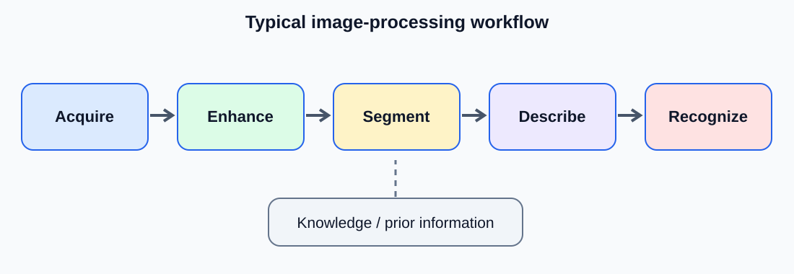
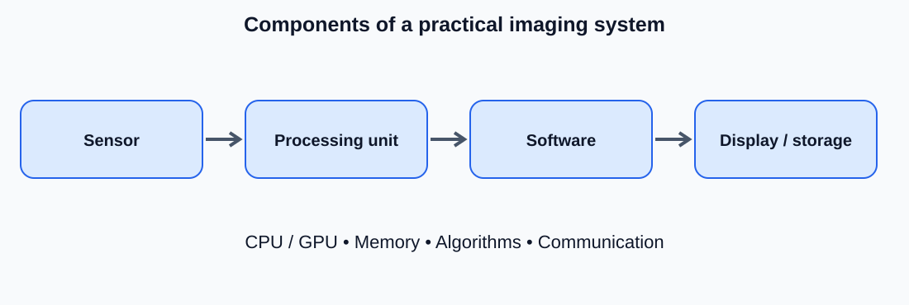

# فصل اول — مقدمه‌ای بر پردازش تصویر دیجیتال

> **درس پردازش تصویر دیجیتال**  
> متن آموزشی مستقل برای مطالعه و انتشار در وب‌سایت  
> مبنای سازمان‌دهی: فصل اول کتاب *Digital Image Processing*، ویرایش چهارم، تألیف Rafael C. Gonzalez و Richard E. Woods.

## اهداف یادگیری

پس از مطالعه این فصل انتظار می‌رود دانشجو بتواند مفهوم تصویر دیجیتال و تفاوت آن با صحنه واقعی را توضیح دهد؛ میان پردازش تصویر، تحلیل تصویر و بینایی ماشین تمایز بگذارد؛ چند کاربرد مهم پردازش تصویر را بشناسد؛ مراحل متداول یک سامانه پردازش تصویر را به‌ترتیب شرح دهد؛ و اجزای سخت‌افزاری و نرم‌افزاری چنین سامانه‌ای را معرفی کند.

## ۱. پردازش تصویر دیجیتال چیست؟

هنگامی که به یک منظره نگاه می‌کنیم، چشم ما نور بازتابیده از اجسام را دریافت می‌کند و مغز آن را تفسیر می‌کند. دوربین نیز نوری را که به حسگر می‌رسد اندازه‌گیری می‌کند؛ اما برای آنکه رایانه بتواند تصویر را ذخیره و پردازش کند، این اندازه‌گیری‌ها باید به اعداد تبدیل شوند.

**تصویر دیجیتال** را می‌توان آرایه‌ای از اعداد دانست. هر خانه از این آرایه، یک **پیکسل** است و مقدار آن اطلاعاتی مانند روشنایی یا رنگ آن نقطه از تصویر را نشان می‌دهد. پردازش تصویر دیجیتال یعنی استفاده از روش‌های محاسباتی برای تغییر، استخراج اطلاعات یا تفسیر این آرایه.

*شکل ۱ — مسیر مفهومی تبدیل صحنه به تصویر دیجیتال و استفاده از آن در تحلیل رایانه‌ای.*

### ۱–۱. یک نمونه ساده

فرض کنید تصویر یک سند قدیمی تاریک است. می‌خواهیم نوشته‌های آن خواناتر شوند. برنامه می‌تواند مقادیر روشنایی پیکسل‌ها را طوری تغییر دهد که متن و زمینه بهتر از یکدیگر متمایز شوند. در این مثال، **ورودی یک تصویر** و **خروجی نیز یک تصویر اصلاح‌شده** است.

اکنون فرض کنید بخواهیم تعداد خودروهای یک تصویر خیابانی را بشماریم. برنامه باید نواحی مربوط به خودروها را پیدا و از دیگر قسمت‌ها جدا کند. این بار، خروجی می‌تواند **تعداد خودروها و مکان آنها** باشد، نه صرفاً تصویر جدید.

به همین دلیل، مرز میان «پردازش تصویر» و «تحلیل تصویر» همواره کاملاً صُلب نیست. در این درس، منظور از پردازش تصویر دیجیتال مجموعه روش‌هایی است که روی تصاویر دیجیتال کار می‌کنند؛ از بهبود ظاهر تصویر تا استخراج اطلاعات مورد نیاز.

### ۱–۲. تصویر به‌عنوان یک آرایه عددی

برای یک تصویر خاکستری، مقدار هر پیکسل معمولاً عددی در بازه ۰ تا ۲۵۵ است، **به شرط آنکه تصویر با ۸ بیت برای هر پیکسل ذخیره شده باشد**:

- `0` نشان‌دهنده سیاه است.
- `255` نشان‌دهنده سفید است.
- اعداد میان این دو، درجات متفاوت خاکستری‌اند.

*شکل ۲ — نمونه آموزشی یک تصویر خاکستری کوچک که هر خانه آن نماینده یک پیکسل و یک مقدار شدت روشنایی است.*

اگر تصویری ۱۰۰۰ سطر و ۱۵۰۰ ستون داشته باشد، در مجموع **۱٬۵۰۰٬۰۰۰ پیکسل** دارد. این عدد تعداد موقعیت‌های مکانی نمونه‌برداری‌شده را نشان می‌دهد، نه لزوماً میزان جزئیات مفید موجود در تصویر.

### ۱–۳. تصویر رنگی چگونه نمایش داده می‌شود؟

در نمایش رایج **RGB**، هر پیکسل به‌جای یک مقدار، سه مؤلفه دارد: قرمز (`R`)، سبز (`G`) و آبی (`B`). برای نمونه، `(255, 0, 0)` قرمز خالص و `(255, 255, 255)` سفید را نشان می‌دهد؛ البته در نمایش استاندارد متداول هشت‌بیتی RGB.

*شکل ۳ — نمایش مفهومی سه مؤلفه قرمز، سبز و آبی در یک تصویر رنگی.*

در فصل‌های بعد خواهیم دید که چرا برای برخی مسائل بهتر است به‌جای RGB از نمایش‌های دیگر رنگ استفاده کنیم.

### ۱–۴. نمونه‌برداری و کوانتیزه‌سازی: دو مفهوم مقدماتی

برای دیجیتال‌کردن تصویر، دو تصمیم مهم می‌گیریم:

**نمونه‌برداری مکانی (Sampling)** مشخص می‌کند تصویر را در چند موقعیت اندازه بگیریم؛ به بیان ساده، تصویر چند سطر و چند ستون پیکسل داشته باشد.

**کوانتیزه‌سازی (Quantization)** مشخص می‌کند مقدار روشنایی هر نمونه با چند سطح مجزا نمایش داده شود. برای مثال، نمایش تنها با دو سطح، تفاوت‌های ظریف خاکستری را از بین می‌برد؛ درحالی‌که ۲۵۶ سطح، درجات بسیار بیشتری از روشنایی را حفظ می‌کند.

*شکل ۴ — مقایسه تعداد سطوح مجاز روشنایی. با کاهش تعداد سطوح، تغییرات پیوسته به پله‌های آشکار تبدیل می‌شوند.*

> **دقت در ساختار درس:** این دو مفهوم در اینجا فقط برای درک معنای «تصویر دیجیتال» معرفی شدند. بحث کامل نمونه‌برداری، کوانتیزه‌سازی و روابط میان پیکسل‌ها در **فصل دوم** کتاب گونزالس و وودز قرار دارد.

## ۲. نگاهی به تاریخچه پردازش تصویر دیجیتال

نیاز به ارسال و بازسازی تصویر، بسیار پیش‌تر از فراگیرشدن رایانه‌های امروزی وجود داشت. در دهه ۱۹۲۰، سامانه‌هایی برای ارسال تصاویر خبری از طریق کابل به کار گرفته شدند و کیفیت آنها به‌تدریج افزایش یافت.

با رشد محاسبات دیجیتال در دهه ۱۹۶۰، پردازش تصویر به شکل نوین گسترش پیدا کرد. تصاویر ارسالی از کاوشگرهای فضایی یکی از نمونه‌های مهم استفاده از رایانه برای اصلاح و تحلیل تصاویر بودند. سپس تصویربرداری پزشکی، پایش صنعتی، سنجش‌ازدور و کاربردهای متعدد دیگر، این حوزه را توسعه دادند.

| دوره | تحول مهم | اهمیت برای پردازش تصویر |
|---|---|---|
| دهه ۱۹۲۰ | ارسال و بازسازی تصاویر خبری | آغاز کاربردهای عملی نمایش عددی تصویر |
| دهه ۱۹۶۰ | گسترش رایانه‌ها و پردازش تصاویر فضایی | استفاده جدی از روش‌های محاسباتی |
| دهه‌های ۱۹۷۰ و ۱۹۸۰ | رشد کاربردهای پزشکی و صنعتی | تبدیل روش‌های پژوهشی به ابزارهای کاربردی |
| دهه‌های ۱۹۹۰ و ۲۰۰۰ | رایانه‌های سریع‌تر، دوربین‌های دیجیتال و GPU | پردازش تصاویر بزرگ‌تر و عملیات سریع‌تر |
| دهه‌های اخیر | روش‌های یادگیری عمیق در تحلیل تصویر | گسترش تشخیص و تفسیر خودکار تصاویر |

مسیر تاریخی نشان می‌دهد که پیشرفت پردازش تصویر تنها نتیجه کشف الگوریتم‌های جدید نبوده است؛ **حسگر بهتر، حافظه بیشتر و توان محاسباتی بالاتر** نیز نقشی اساسی داشته‌اند.

## ۳. کاربردهای پردازش تصویر دیجیتال

یک ویژگی مهم این دانش آن است که ورودی آن لزوماً تصویر ثبت‌شده با دوربین معمولی نیست. هر وسیله‌ای که از یک پدیده فیزیکی داده‌ای مکانی و قابل‌نمایش به‌صورت تصویر تولید کند، می‌تواند منبع داده برای پردازش تصویر باشد.

### ۳–۱. تصویربرداری در طیف الکترومغناطیسی

بخشی از تصاویر از انرژی الکترومغناطیسی حاصل می‌شوند؛ اما همه آنها در محدوده نور مرئی قرار ندارند:

| نوع تصویربرداری | نمونه کاربرد | اطلاعات مورد توجه |
|---|---|---|
| پرتو گاما | برخی روش‌های تصویربرداری پزشکی و اخترشناسی | توزیع تابش یا رویدادهای انرژی بالا |
| پرتو ایکس | رادیوگرافی و سی‌تی‌اسکن | تفاوت جذب یا تضعیف پرتو در مواد |
| فرابنفش | بررسی مواد و برخی کاربردهای علمی | پاسخ ماده در محدوده فرابنفش |
| نور مرئی | دوربین، اسکن سند، کنترل کیفیت | رنگ، شکل، بافت و روشنایی |
| فروسرخ | تصویربرداری حرارتی و سنجش‌ازدور | تابش حرارتی یا بازتاب فروسرخ، بسته به سامانه |
| مایکروویو / رادار | سنجش‌ازدور و تصویربرداری راداری | ویژگی‌های بازتاب امواج راداری |
| امواج رادیویی | تصویربرداری تشدید مغناطیسی (MRI) | سیگنال‌های ناشی از رزونانس هسته‌ای در میدان مغناطیسی |

نکته مهم این است که **معنای روشنایی پیکسل** در هر یک از این سامانه‌ها یکسان نیست. برای مثال، شدت روشنایی در تصویر عادی معمولاً به نور ثبت‌شده مربوط است؛ اما در تصویر پزشکی ممکن است نشان‌دهنده کمیتی کاملاً متفاوت باشد.

### ۳–۲. تصویربرداری مبتنی بر روش‌های دیگر

علاوه بر امواج الکترومغناطیسی، تصویر را می‌توان از **امواج صوتی** یا ابزارهای دیگر ساخت. برای نمونه، در سونوگرافی، امواج صوتی به بافت فرستاده می‌شوند و بازتاب آنها مبنای تشکیل تصویر است. در میکروسکوپ الکترونی نیز اطلاعات تصویری از برهم‌کنش پرتو الکترونی با نمونه حاصل می‌شود.

### ۳–۳. چند مسئله ملموس

- **پزشکی:** افزایش وضوح ساختارهای قابل مشاهده، جداسازی ناحیه مورد نظر و کمک به اندازه‌گیری‌ها.
- **صنعت:** شناسایی خراش، ترک یا قطعه معیوب در تصویر محصول.
- **ماهواره و محیط‌زیست:** پایش تغییر پوشش زمین، پوشش گیاهی یا گسترش شهرها.
- **اسناد:** کاهش نویز، اصلاح کجی صفحه و آماده‌سازی برای تشخیص متن.
- **رباتیک و حمل‌ونقل:** تشخیص مسیر، مانع یا شیء در تصویر دوربین.
- **نجوم و پژوهش علمی:** کاهش آثار نامطلوب اندازه‌گیری و استخراج ویژگی‌های قابل بررسی.

**وجه مشترک همه این مثال‌ها چیست؟** ابتدا داده‌ای به شکل تصویر در اختیار داریم؛ سپس باید مسئله دقیق را تعریف کنیم. هیچ الگوریتمی صرفاً به این دلیل که «تصویر را زیباتر می‌کند»، برای تمام این کاربردها مناسب نیست.

## ۴. مراحل اساسی یک سامانه پردازش تصویر

یکی از مهم‌ترین بخش‌های فصل اول، شناخت نقشه کلی فعالیت‌های پردازش تصویر است. این نقشه کمک می‌کند دانشجو بداند هر مبحثِ فصل‌های بعد در کدام قسمت مسئله قرار می‌گیرد.

*شکل ۵ — نمای ساده‌شده جریان پردازش تصویر. نمودار آموزشی است و همه پروژه‌ها الزاماً تمام مراحل آن را ندارند. پایگاه دانش می‌تواند بر مراحل مختلف اثر بگذارد.*

### ۴–۱. اخذ تصویر (Image Acquisition)

نخست، تصویر باید توسط دوربین، اسکنر، حسگر پزشکی، ماهواره یا سامانه مشابهی دریافت شود. در همین مرحله ممکن است اصلاحات اولیه‌ای انجام شود؛ مانند تنظیم مقیاس داده یا تبدیل خروجی حسگر به قالب قابل‌استفاده.

**مثال:** ثبت تصویر یک قطعه صنعتی در خط تولید.

### ۴–۲. بهبود تصویر (Image Enhancement)

هدف بهبود تصویر، مناسب‌ترکردن ظاهر آن برای مشاهده انسان یا پردازش بعدی است. برای مثال می‌توان کنتراست را افزایش داد یا بخش‌های تاریک را روشن‌تر کرد.

**نکته:** تصویری که از نظر بصری زیباتر است، لزوماً برای یک الگوریتم تشخیص خودکار بهتر نیست. کیفیت بهبود تصویر باید متناسب با کاربرد ارزیابی شود.

### ۴–۳. بازیابی تصویر (Image Restoration)

در بازیابی تصویر تلاش می‌کنیم آثار یک فرایند تخریب شناخته‌شده یا مدل‌شده را کاهش دهیم؛ مثلاً تاری ناشی از حرکت یا برخی انواع نویز. تفاوت مفهومی آن با بهبود تصویر در این است که **بازیابی معمولاً به مدل تخریب تکیه می‌کند**، درحالی‌که بهبود می‌تواند براساس مطلوبیت دیداری انجام شود.

### ۴–۴. پردازش تصویر رنگی (Color Image Processing)

گاهی اطلاعات رنگ برای تشخیص موضوع بسیار مهم است. مثال ساده آن تشخیص میوه رسیده از نارس بر اساس ویژگی‌های رنگ است. در این دسته از روش‌ها، مؤلفه‌های رنگ و شیوه نمایش آنها نقش اصلی دارند.

### ۴–۵. پردازش چندمقیاسی و موجک‌ها (Wavelets and Multiresolution)

ممکن است یک ویژگی در مقیاس کوچک آشکار شود و ویژگی دیگر تنها در نمای کلی تصویر دیده شود. تحلیل چندمقیاسی به ما امکان می‌دهد ساختار تصویر را در اندازه‌های مختلف بررسی کنیم.

### ۴–۶. فشرده‌سازی (Compression)

تصاویر می‌توانند حافظه زیادی اشغال کنند. هدف فشرده‌سازی، کاهش حجم داده برای ذخیره یا انتقال آسان‌تر است. برخی روش‌ها **بدون اتلاف** هستند و بازسازی دقیق داده اولیه را ممکن می‌کنند؛ برخی روش‌ها **با اتلاف** هستند و در برابر کاهش حجم بیشتر، بخشی از اطلاعات را حذف می‌کنند.

### ۴–۷. پردازش ریخت‌شناختی (Morphological Processing)

در این روش‌ها، شکل و ساختار نواحی تصویر بررسی و اصلاح می‌شود. برای نمونه، می‌توان حفره‌های کوچک داخل یک شیء را پر کرد یا ذرات ریز ناخواسته را کاهش داد. این عملیات در تصاویر دودویی و خاکستری کاربرد دارند.

### ۴–۸. بخش‌بندی تصویر (Segmentation)

بخش‌بندی یعنی جداکردن نواحی یا اشیای مورد علاقه از بخش‌های دیگر تصویر. برای مثال در تصویر دانه‌های برنج، می‌خواهیم ناحیه هر دانه را از زمینه جدا کنیم. اگر بخش‌بندی درست انجام نشود، اندازه‌گیری و تشخیص بعدی نیز ممکن است نادرست باشد.

### ۴–۹. استخراج ویژگی و توصیف (Feature Extraction and Description)

پس از مشخص‌شدن ناحیه مورد نظر، می‌توان از آن ویژگی‌های عددی استخراج کرد؛ مانند مساحت، محیط، شکل، بافت، مکان و جهت. این ویژگی‌ها امکان مقایسه اشیا را فراهم می‌کنند.

### ۴–۱۰. شناسایی و دسته‌بندی (Recognition / Classification)

در نهایت ممکن است بخواهیم براساس ویژگی‌ها یا خود تصویر، برچسبی به شیء اختصاص دهیم؛ برای نمونه «قطعه سالم» یا «قطعه معیوب». روش‌های کلاسیک و روش‌های یادگیری ماشین یا یادگیری عمیق می‌توانند در این مرحله به کار روند.

### ۴–۱۱. پایگاه دانش (Knowledge Base)

دانش قبلی درباره مسئله می‌تواند به انتخاب ناحیه بررسی، تنظیم پارامترها و تفسیر نتیجه کمک کند. برای نمونه، اگر بدانیم قطعه صنعتی همواره در بخش میانی تصویر قرار می‌گیرد، لازم نیست تمام تصویر را با یک روش پیچیده جست‌وجو کنیم.

> **جمع‌بندی این بخش:** شکل ۵ مسیر یادگیری را ساده می‌کند؛ اما در کتاب گونزالس و وودز، مراحل متنوع‌تری مانند بازیابی، فشرده‌سازی، موجک، مورفولوژی و پردازش رنگ نیز به‌صراحت مطرح می‌شوند. بنابراین شکل را نباید فهرست کامل یا ترتیب اجباری همه مراحل تلقی کرد.

## ۵. اجزای یک سامانه پردازش تصویر

برای ساخت یک سامانه عملی، داشتن الگوریتم به‌تنهایی کافی نیست. باید معلوم باشد تصویر چگونه ثبت، منتقل، ذخیره، پردازش و نمایش داده می‌شود.

*شکل ۶ — نمایش ساده‌شده اجزای عمومی یک سامانه پردازش تصویر دیجیتال.*

**حسگر و دیجیتال‌کننده:** حسگر، پاسخ فیزیکیِ مرتبط با صحنه را دریافت می‌کند. سپس داده باید به شکل دیجیتال درآید. در بعضی دستگاه‌ها، این مراحل درون همان سخت‌افزار دوربین انجام می‌شوند.

**سخت‌افزار پردازش اختصاصی:** برخی کارها باید با سرعت زیاد انجام شوند. بسته به نیاز، سخت‌افزار ویژه یا پردازنده گرافیکی (`GPU`) می‌تواند مفید باشد.

**رایانه و حافظه:** رایانه عملیات را اجرا می‌کند و حافظه، تصاویر و داده‌های میانی را نگه می‌دارد. تصویرهای پرحجم به حافظه و پهنای باند بیشتری نیاز دارند.

**نرم‌افزار:** الگوریتم‌های دریافت، بهبود، تحلیل و نمایش تصویر را پیاده‌سازی می‌کند. زبان‌های برنامه‌نویسی و کتابخانه‌های تصویری ابزار ساخت این بخش‌اند.

**ذخیره‌سازی:** تصاویر خام، تصاویر پردازش‌شده و نتایج استخراج‌شده می‌توانند در فضای ذخیره‌سازی نگهداری شوند.

**نمایشگر و تجهیزات خروجی:** نتایج ممکن است روی صفحه نمایش داده شوند، چاپ شوند یا به سامانه کنترل و تصمیم‌گیری فرستاده شوند.

**شبکه ارتباطی:** در سامانه‌های بزرگ، تصویر ممکن است از محل دریافت به رایانه دیگر یا فضای ذخیره‌سازی شبکه منتقل شود.

### ۵–۱. مثال: کنترل کیفیت یک محصول

یک دوربین از محصول روی نوار نقاله عکس می‌گیرد. داده دیجیتال به رایانه منتقل می‌شود. نرم‌افزار ابتدا روشنایی را بررسی می‌کند، سپس ناحیه محصول را جدا و ویژگی‌های هندسی آن را اندازه می‌گیرد. اگر ویژگی‌ها از محدوده مجاز خارج باشند، سامانه یک خروجی هشدار یا فرمان جداسازی محصول صادر می‌کند.

این مثال نشان می‌دهد که **پردازش تصویر یک زنجیره مهندسی** است و کیفیت پاسخ نهایی به نورپردازی، کیفیت ثبت تصویر، الگوریتم و نحوه استفاده از نتیجه وابسته است.

## ۶. مقایسه چند اصطلاح مهم

| اصطلاح | پرسش اصلی | نمونه خروجی |
|---|---|---|
| پردازش تصویر | چگونه تصویر را تغییر دهیم یا داده آن را پردازش کنیم؟ | تصویر با کنتراست بهتر |
| تحلیل تصویر | چه ویژگی یا کمیتی در تصویر وجود دارد؟ | مساحت یک ناحیه |
| بینایی ماشین | سامانه از تصویر چه برداشتی برای انجام وظیفه دارد؟ | تشخیص و مکان‌یابی قطعه |
| شناسایی الگو | داده یا شیء به کدام دسته تعلق دارد؟ | سالم / معیوب |

این تمایزها برای آموزش مفیدند، اما در عمل هم‌پوشانی دارند. یک پروژه بینایی ماشین معمولاً از چند مرحله پردازش و تحلیل تصویر استفاده می‌کند.

## ۷. مثال آموزشی یکپارچه

**مسئله:** می‌خواهیم تعداد پیچ‌های موجود روی یک صفحه را از روی عکس بشماریم.

1. **دریافت:** یک عکس با نورپردازی مناسب می‌گیریم.
2. **بهبود:** اگر تصویر کم‌کنتراست باشد، روشنایی یا کنتراست را متناسب با مسئله تنظیم می‌کنیم.
3. **بخش‌بندی:** نواحی مربوط به پیچ‌ها را از زمینه جدا می‌کنیم.
4. **تحلیل:** اجزای جداشده را بررسی می‌کنیم و اجسام کوچکِ نویزی را کنار می‌گذاریم.
5. **خروجی:** تعداد پیچ‌ها و در صورت نیاز مکان هر پیچ را گزارش می‌کنیم.

اگر از همان ابتدا عکس تار، بسیار تیره یا دارای انعکاس شدید باشد، ممکن است حتی بهترین الگوریتم نیز پاسخ قابل‌اعتمادی ندهد. بنابراین در طراحی پروژه، **کیفیت اخذ تصویر** به‌اندازه انتخاب الگوریتم اهمیت دارد.

## ۸. پرسش‌های مروری فصل

1. چرا یک تصویر دیجیتال را می‌توان آرایه‌ای از اعداد دانست؟
2. تفاوت خروجی «افزایش کنتراست تصویر» و «شمارش خودروهای تصویر» چیست؟
3. نمونه‌برداری مکانی با کوانتیزه‌سازی چه تفاوتی دارد؟
4. آیا تمام تصاویر دیجیتال با نور مرئی تشکیل می‌شوند؟ دو مثال نقض بیان کنید.
5. بهبود تصویر و بازیابی تصویر چه تفاوت مفهومی دارند؟
6. بخش‌بندی تصویر چه نقشی در شمارش اشیا دارد؟
7. چرا استخراج ویژگی معمولاً پس از مشخص‌شدن ناحیه مورد نظر انجام می‌شود؟
8. پایگاه دانش چگونه می‌تواند پردازش تصویر را ساده‌تر کند؟
9. در سامانه کنترل کیفیت، نقش حسگر، رایانه و نرم‌افزار چیست؟
10. آیا همه سامانه‌های پردازش تصویر باید تمام مراحل معرفی‌شده را اجرا کنند؟ دلیل بیاورید.

## ۹. تمرین عملی کوتاه

یک عکس خاکستری را در نرم‌افزار تصویری یا محیط برنامه‌نویسی باز کنید و سه کار انجام دهید: اندازه تصویر را بر حسب سطر و ستون گزارش کنید؛ مقدار روشنایی چند پیکسل انتخابی را بخوانید؛ و تصویر را یک بار با روشنایی بیشتر و یک بار با کنتراست متفاوت نمایش دهید. سپس توضیح دهید در هر تغییر، **چه چیزی در اعداد پیکسل‌ها تغییر کرده است**.

## ۱۰. نکات کلیدی فصل

- تصویر دیجیتال از نمونه‌های مکانی دارای مقادیر عددی تشکیل می‌شود.
- پردازش تصویر می‌تواند خروجی تصویری یا اطلاعات عددی و معنایی تولید کند.
- تصویربرداری دیجیتال محدود به دوربین و نور مرئی نیست.
- اخذ تصویر، بهبود، بازیابی، بخش‌بندی، استخراج ویژگی و شناسایی نمونه‌هایی از مراحل مهم‌اند.
- مراحل سامانه به مسئله وابسته‌اند و ترتیب آنها همیشه یکسان نیست.
- تجهیزات اخذ تصویر، حافظه، پردازنده، نرم‌افزار و تجهیزات خروجی بر نتیجه اثر می‌گذارند.
- پیش از انتخاب الگوریتم، باید مسئله و معیار موفقیت آن روشن باشد.

## منبع درسی

Gonzalez, R. C., & Woods, R. E., *Digital Image Processing*, 4th Edition, Pearson — Chapter 1: **Introduction**.

---

*تمام شکل‌های این صفحه برای همین محتوای آموزشی ترسیم شده‌اند و در پوشه `assets` همراه فایل قرار دارند. برای نمایش صحیح در وب‌سایت، ساختار پوشه‌ها را حفظ کنید.*

<!-- SADOGHI_CHAPTER_DOWNLOADS_BEGIN -->
## فایل‌های قابل دانلود

- **ZIP — دریافت متن و شکل‌های فصل اول**: <a href="/assets/downloads/courses/image-processing/gonzalez/chapter-01/chapter-01.zip">دریافت فایل</a> (14.3 KB)
  - نسخه قابل دانلود متن Markdown فصل اول به همراه شش تصویر SVG؛ شامل کتاب اصلی یا کد اجرایی نیست.

<!-- SADOGHI_CHAPTER_DOWNLOADS_END -->

