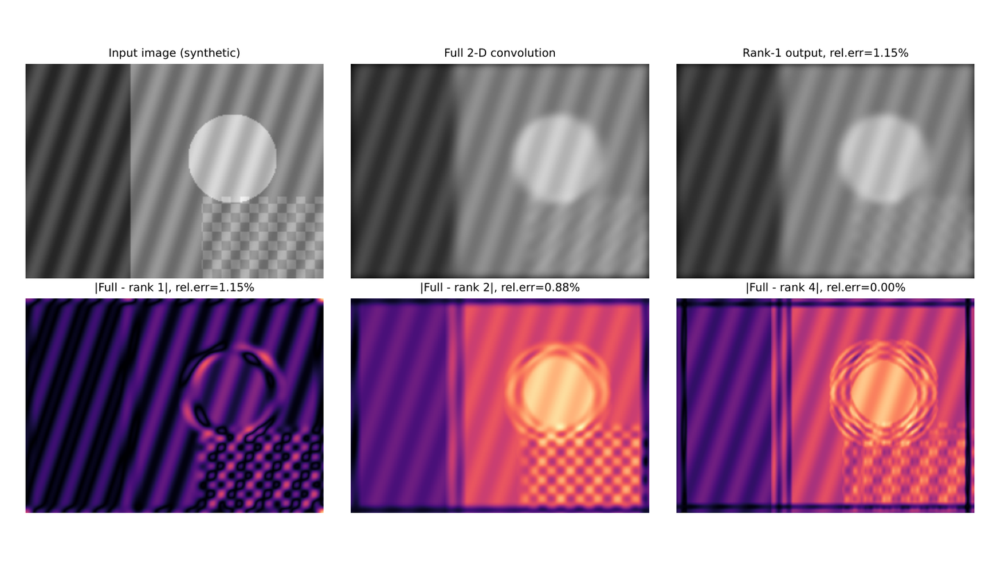
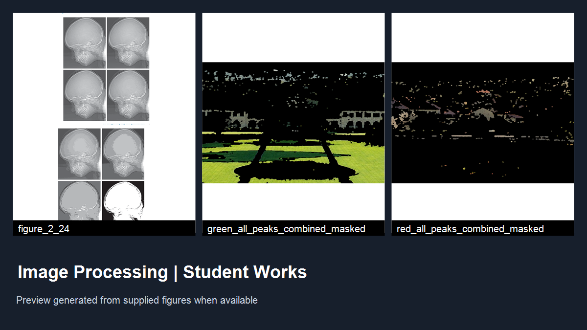

<!-- GENERATED BY student_work_book_sync.py; DO NOT EDIT DIRECTLY -->
# Section 3

Approved student projects in this section.

## [Low-Rank Approximation of 2-D Convolution Filters Using SVD](svd-low-rank-separable-convolution.md)

This student project studies how singular value decomposition (SVD) can approximate a non-separable 2-D convolution kernel with lower-rank separable filters. The package includes a Persian report, Python implementation, numerical results, and example figures comparing full filtering with rank-1, rank-2, and rank-4 approximations. It is directly relevant to image processing topics such as spatial filtering, separability, computational efficiency, and approximation error.

## [RGB Color Segmentation Using Dominant Channels and Histogram Peaks](rgb-based-segmentation-project.md)

A student image-processing project documenting RGB color segmentation with channel-dominance masks, Gaussian-smoothed histograms, adaptive peak intervals, and morphological post-processing. The report also compares the RGB approach conceptually with HSV segmentation. The uploaded archive contains LaTeX documentation; any locally supplied figures will be displayed as submitted, not represented as independently reproduced results.

