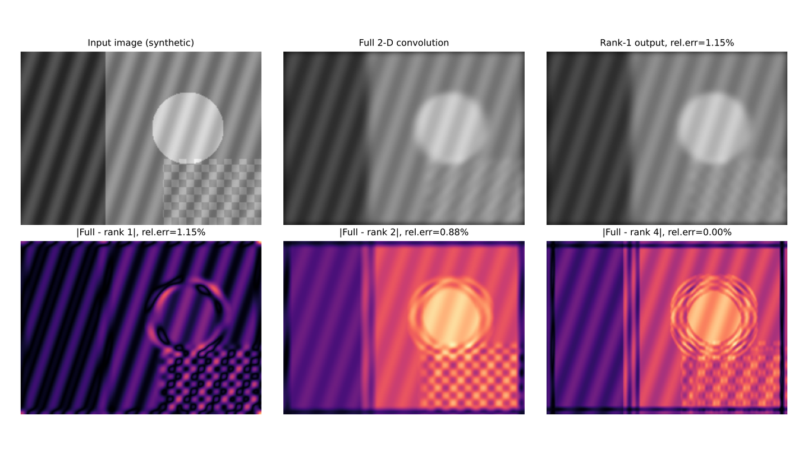

<!-- GENERATED BY student_work_book_sync.py; DO NOT EDIT DIRECTLY -->
# Low-Rank Approximation of 2-D Convolution Filters Using SVD

## Overview

This student project studies how singular value decomposition (SVD) can approximate a non-separable 2-D convolution kernel with lower-rank separable filters. The package includes a Persian report, Python implementation, numerical results, and example figures comparing full filtering with rank-1, rank-2, and rank-4 approximations. It is directly relevant to image processing topics such as spatial filtering, separability, computational efficiency, and approximation error.

## Project figures

*Figures are taken from the files submitted for this project.*

## Project description

### Project overview

This project examines how singular value decomposition (SVD) can accelerate two-dimensional image filtering by approximating a convolution kernel as a sum of separable components. A rank-one kernel requires only one horizontal and one vertical one-dimensional filtering operation; a higher-rank kernel can be approximated by combining a small number of such components.

The accompanying Persian report develops the relation between matrix rank and kernel separability, presents the truncated SVD approximation and discusses the Eckart–Young–Mirsky theorem. It also derives an image-domain error bound and explains why the best low-rank approximation of a **kernel** need not produce the smallest output error on every image.

The provided Python script uses NumPy, SciPy and Matplotlib to construct examples, plot singular values, compare approximated kernels and display filtered outputs. One numerical experiment applies a nonseparable **19 × 19** filter to a synthetic image, comparing full convolution with rank-1, rank-2 and rank-4 separable approximations. Six vector PDF figures and the numerical-results text accompany the project.

### Numerical results supplied with the project

The values below are reproduced from the submitted `numerical_results.txt`; they have **not** been independently recomputed in this publication preparation.

| Retained rank | Relative Frobenius kernel error | Relative image-output L2 error |
|---|---:|---:|
| 1 | 0.1627713812 | 0.01147098809 |
| 2 | 0.02557585345 | 0.008771160683 |
| 4 | 0.0004722306618 | 0.00004027099014 |

The project additionally reports a maximum absolute deviation of approximately `2.0e-15` between direct convolution and a full-SVD separable reconstruction in its constructed example.

### How to explore the material

The source ZIP contains the editable Persian LaTeX report, a Python figure-generation script, six vector figures, the numerical-results file and a README. The code lists `numpy`, `scipy` and `matplotlib` as Python dependencies. Producing the Persian PDF from source requires a suitable XeLaTeX installation and Persian fonts.

The experimental image is synthetic. These results demonstrate approximation behavior for the supplied experiment; they should not be interpreted as benchmarked speedups or verified performance on a broad collection of real images.

**Authorship note:** An author identity has not been independently established from the contents. Student names are intentionally omitted from the public metadata.

## Downloads

- [Project source package (ZIP)](https://h-sadoghi.github.io/assets/downloads/courses/image-processing/student-works/svd-low-rank-separable-convolution/svd-low-rank-separable-convolution-01.zip) (915.8 KB) — Converted ZIP package containing the original project files, report source, Python code, numerical outputs, and figures.
- [Persian project report (PDF)](https://h-sadoghi.github.io/assets/downloads/courses/image-processing/student-works/svd-low-rank-separable-convolution/svd-low-rank-separable-convolution-02.pdf) (534.9 KB) — Main Persian report explaining SVD, low-rank approximation, separable convolution, implementation details, and discussion.
- [Filtered output comparison figure (PDF)](https://h-sadoghi.github.io/assets/downloads/courses/image-processing/student-works/svd-low-rank-separable-convolution/svd-low-rank-separable-convolution-03.pdf) (328.1 KB) — Example figure comparing the original filtered image with rank-1, rank-2, and rank-4 approximations.

[← Back to Section 3](index.md)
